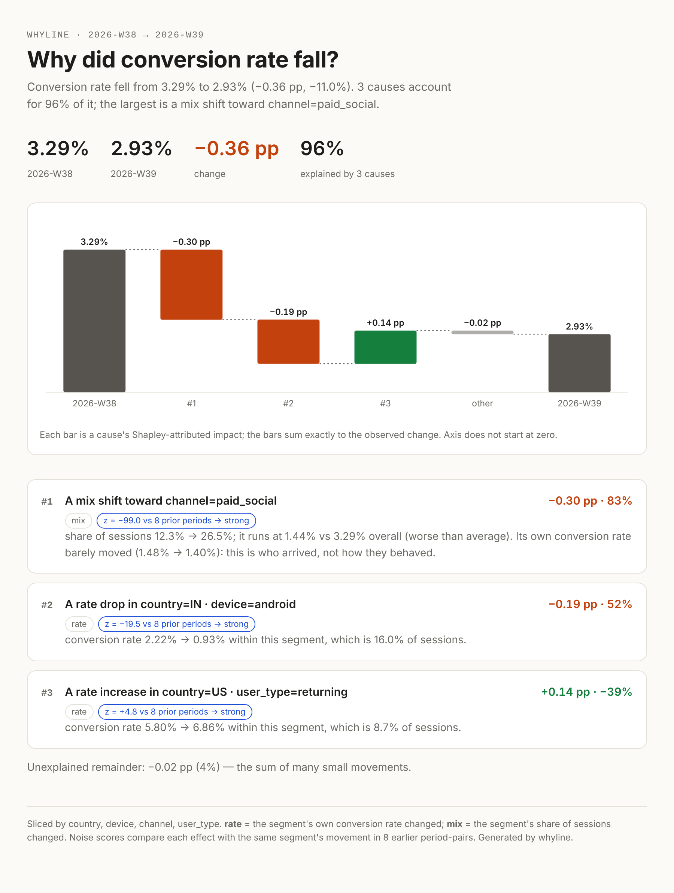

# whyline

**Your conversion rate dropped 11% this week. whyline tells you why — in 25 milliseconds.**

```text
$ whyline explain events.csv --ratio conversions/sessions --by country,device,channel,user_type --time week --percent

whyline · conversion rate · 2026-W38 → 2026-W39

  3.29% → 2.93%   ▼ −0.36 pp, −11.0%

  3 causes explain 96% of the change.

   #        impact   share  mechanism  segment
   1      −0.30 pp     83%  mix        channel=paid_social
                                       share of sessions 12.3% → 26.5%; it runs at 1.44% vs 3.29% overall
                                       (worse than average).
                                       Its own conversion rate barely moved (1.48% → 1.40%):
                                       this is who arrived, not how they behaved.
                                       z = −99.0 vs 8 prior periods → strong
   2      −0.19 pp     52%  rate       country=IN · device=android
                                       conversion rate 2.22% → 0.93% within this segment, which is 16.0% of sessions.
                                       z = −19.5 vs 8 prior periods → strong
   3      +0.14 pp    −39%  rate       country=US · user_type=returning
                                       conversion rate 5.80% → 6.86% within this segment, which is 8.7% of sessions.
                                       z = +4.8 vs 8 prior periods → strong
          −0.02 pp      4%             unexplained
```

Read that again. The biggest "drop" isn't a bug at all — marketing launched a campaign that brought
low-intent traffic. The real incident is an Android payment failure in India. And a promotion in the
US was quietly *hiding* part of the damage. A dashboard shows you a red number; whyline gives you the
three sentences your team actually needs.

<p align="center"></p>

---

## Why this is hard (and why dashboards get it wrong)

Every company with a metric has lived this: a KPI moves, someone opens a dashboard, sorts segments by
"biggest change", and starts a Slack thread. That approach fails in predictable ways:

| Trap | What happens | How whyline handles it |
|---|---|---|
| **Mix vs. rate** | A segment "dragging the average down" may not have changed at all — there's just more of it. | Every cause is labelled **rate** (behaviour changed) or **mix** (composition changed), using an exact Shapley split. |
| **Simpson's paradox** | A traffic surge in one channel makes the *aggregate* rate of every country and device look worse. | Rate is measured cell-by-cell at the finest grain, so composition shifts can never masquerade as behaviour change. |
| **Wrong granularity** | "India is down" when it's really *Android in India*; or "new users on paid-social" when the whole channel surged. | Drill-down only when a child carries most of the effect **and** is measurably more intense than its parent. |
| **Double counting** | Overlapping segments each claim the same dollars, and the bars add up to 140%. | Impacts are exact **Shapley values** of a counterfactual game — they always sum to the observed change. |
| **Noise** | With 50 segments, a few always look dramatic. | Each cause is scored against its own history, with a multiple-comparison-corrected, small-sample (Student-t) gate. Quiet weeks say "within normal variation". |
| **Side-effects** | One incident shows up as five "causes". | **Explaining away:** a cause that no longer matters once the others are accounted for is dropped. |

## How it works

whyline treats root-cause analysis as a **counterfactual** question:
*how much of the change disappears if this segment had behaved like it did last week?*

1. **Decompose.** For a ratio metric `R = Σnᵢ / Σdᵢ = Σ wᵢ·rᵢ`, each segment's contribution splits
   exactly into
   `mix  = (w₁−w₀)·(r̄ᵢ − R̄)` and `rate = (r₁−r₀)·(w₀+w₁)/2` —
   the two-player Shapley value of the product `w·r`, centred on the overall average so that a
   growing segment only matters if it's better or worse than average. Over any partition these sum
   to `R₁ − R₀` to machine precision.
2. **Discover.** Greedily pick the segment × mechanism with the largest counterfactual effect,
   drill down while warranted, *neutralize* it (rewrite the current period as if that cause never
   happened), and search what's left. Neutralizations are applied cell-wise, so overlapping causes
   commute instead of double-counting.
3. **Gate.** Compare each candidate's effect to how the same segment moved in previous periods.
   If the headline change is itself unusual, material causes need |z| ≥ 3; everything else must
   clear a Bonferroni-corrected Student-t threshold across the whole search, and every cause must move
   the headline metric by a noticeable fraction of its normal weekly movement.
4. **Attribute.** Compute exact Shapley values over the set of discovered causes in the game
   `v(S) = metric after neutralizing S`. Order-independent, and the waterfall always closes.
5. **Explain away.** Drop the weakest cause that no longer matters once all others are neutralized;
   recompute; repeat.

Everything runs on boolean masks over a small numpy cube — no model training, no GPU, ~25 ms for
180 segments × 10 periods.

## Benchmark: does it find the truth?

Synthetic data lets us plant incidents and check. `benchmarks/recovery.py` generates 10 weeks of
funnel data (4 dimensions, 180 cells, realistic binomial + seasonal noise), plants 0–3 random
incidents in the last week — conversion shocks or traffic surges/drops on random 1- or
2-dimension segments — and compares methods. An incident counts as a cause to find when it moves
the metric by more than one standard deviation of normal week-to-week movement.

Held-out run (`python benchmarks/recovery.py 300 42`, a seed never used for tuning):

| method | recall | precision | F1 |
|---|---:|---:|---:|
| **whyline** | **75%** | **70%** | **72%** |
| "top movers" (rank all depth≤2 segments by contribution, *told* the true number of incidents) | 45% | 45% | 45% |

On weeks with nothing material planted, whyline reported a cause 6 times in 80 (7.5%).

**Honest limitations.** Most misses are small incidents near the detection threshold, or traffic
shifts in a two-dimensional slice that get attributed to one parent dimension. Neutralization is a
model of "what would have happened" — it assumes segments are independent, which real systems
violate (a checkout outage also changes which users come back tomorrow). whyline explains *where*
a change came from, not *why* the world did it; that last step is still yours.

## Install & use

```bash
git clone https://github.com/sumit200531/whyline && cd whyline
pip install -e ".[dev]"
whyline demo --html demo.html          # synthetic data with planted incidents, plus the answer key
pytest                                  # 13 tests, < 1 s
```

### Python

```python
import whyline as wl

result = wl.explain(
    df,                                         # long format: one row per period × segment (or finer)
    wl.Ratio("conversions", "sessions", name="conversion rate", percent=True),
    dimensions=["country", "device", "channel", "user_type"],
    time="week",                                # baseline/current default to the last two periods
)

print(result.headline())
# Conversion rate fell from 3.29% to 2.93% (−0.36 pp, −11.0%). 3 causes account for 96% of it;
# the largest is a mix shift toward channel=paid_social.

result.to_html("report.html")   # self-contained, no JS, light/dark aware
result.to_frame()               # pandas DataFrame of causes
result.to_dict()                # JSON-ready
result                          # renders as HTML in Jupyter
```

Metrics: `wl.Sum("revenue")` for additive metrics; `wl.Ratio(num, den)` for conversion rate,
CTR, AOV (`revenue/orders`), ARPU, error rate, latency per request, and so on.

### CLI

```bash
whyline explain data.csv --sum revenue --by country,device --time week
whyline explain data.parquet --ratio errors/requests --by region,service,version --time hour \
        --baseline "2026-10-15 13:00" --current "2026-10-15 14:00" --json
```

## Project layout

```
whyline/
  metrics.py   Sum / Ratio: value, Shapley mix-rate split, cell-wise counterfactuals
  cube.py      the segment × period arrays everything runs on
  explain.py   discovery, noise gate, Shapley attribution, explaining away
  report.py    headline, terminal report, HTML report with SVG waterfall
  synth.py     funnel simulator with planted incidents (demo + benchmark ground truth)
  cli.py       `whyline explain` / `whyline demo`
benchmarks/recovery.py   planted-incident recovery benchmark vs. top-movers
tests/                   maths invariants, end-to-end recovery, CLI
```

## Where this goes next

whyline is deliberately small, but the core is the hard part. The obvious extensions:

- **Warehouse pushdown** — generate the cube with one `GROUP BY` in Snowflake / BigQuery / DuckDB
  so it runs on billions of rows without moving them.
- **Always-on monitoring** — run on every metric every hour; alert only when the headline change is
  unusual, with the explanation already attached (Slack / email / PagerDuty).
- **Narratives** — hand the structured causes to an LLM for a paragraph in the house style; the
  numbers stay deterministic and auditable.
- **Metric trees** — explain revenue = traffic × conversion × AOV jointly, so a revenue drop is
  traced through the funnel stage that broke.
- **Forecast baselines** — compare against a seasonal forecast instead of last week.

## License

MIT
